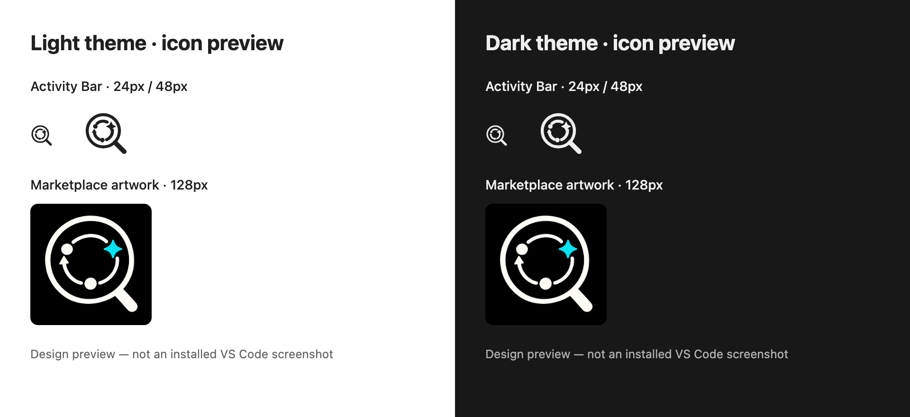

# Maister Lens identity

The chosen mark combines a magnifying lens, an iterative software lifecycle and a
four-point turquoise AI accent. The lens signals inspection; the loop signals ongoing
planning, development and verification.

## Assets

| Asset | Purpose | Theme behavior |
|---|---|---|
| `media/icon.png` | Marketplace and Extensions listing | Opaque black background, off-white lens, turquoise accent; same artwork in all themes |
| `media/maister.svg` | Activity Bar | Transparent, monochrome 24×24 SVG; VS Code applies the active theme's icon color |

The PNG is the selected 1254×1254 generated artwork, copied into this repository so
building does not depend on a local Codex image cache. The SVG is a simplified native
vector rendering of the same lifecycle motif, adapted for small sizes. Keep the
Activity Bar SVG free of a solid background and fixed brand colors.

The Marketplace PNG does not switch with the editor theme. Its black tile is intentional:
white geometry remains visible on both light and dark listing surfaces. Do not use that
PNG as the Activity Bar mask.

## Extension screenshots

The root [README](../../README.md#screenshots) displays the installed extension in
this order: dark Dashboard, dark Project, light Dashboard, light Project.

| Screenshot | View | Theme |
|---|---|---|
| [dashboard-dark.png](dashboard-dark.png) | Cross-task Dashboard | Dark |
| [project-dark.png](project-dark.png) | Project documentation | Dark |
| [dashboard-light.png](dashboard-light.png) | Cross-task Dashboard | Light |
| [project-light.png](project-light.png) | Project documentation | Light |

These are the original screenshots supplied on 2026-10-15, renamed without changing
their contents. Keep these filenames stable when replacing screenshots.

The Marketplace description uses the root README. During packaging, `vsce` rewrites
its relative image paths to public GitHub URLs using `HEAD` (the default branch).
Push the screenshots to `main` before publishing the updated extension, then check
the listing's images.
The GitHub repository must be public: Marketplace visitors cannot load images from
a private repository. Verify every image URL from the packaged README without signing
in; a successful VSIX build does not check whether those URLs are accessible.
The screenshots stay outside the VSIX because `.vscodeignore` excludes `docs/**`.

## Provenance

The PNG was created using the built-in image generation tool and selected in the design
conversation. Final edit prompt: preserve the circular lens, lower-right handle, inner
lifecycle path, upper-left and bottom nodes, left upward arrow and upper-right turquoise
sparkle; render all negative space on opaque pure black; remove haze and halos; no text,
new symbols, gradients, glow or shadows. The SVG was authored directly for VS Code.

## Preview

Rebuild this layout preview with `node scripts/preview-branding.mjs` after installing
Playwright Chromium. This is an HTML rendering of the assets, not a VS Code screenshot.

## Verification

The DOM theme suite exercises built-in webview surfaces with representative light,
dark and high-contrast tokens, including live theme changes and filter color pairing.
The branding screenshot above is a layout preview, not an installed-extension screenshot.
Actual Activity Bar rendering and third-party authored HTML remain in the manual
[release checklist](../RELEASING.md).
